  

I build the infrastructure underneath AI agents: how they **remember**, how you **observe** them, and how you make them **reproducible**. Before going independent, I built distributed systems from 2019 at Amazon and PropertyFinder.

### Building

| | |
|---|---|
| **[extremis](https://github.com/ashwanijha04/extremis)** &nbsp; | Layered memory for AI agents: log-first, RL-scored retrieval, consolidation-backed. MCP-native, so it plugs into Claude Desktop in one line. `pip install "extremis[mcp]"` |
| **[peekr](https://github.com/ashwanijha04/peekr)** &nbsp; | In-process observability, evaluation and compliance guardrails for AI agents. No proxy, so your data never leaves your stack. Claim-level hallucination detection. `pip install peekr` |

### Experience

**PropertyFinder** · Senior Software Engineer · Dubai

**Amazon** · 2019 – 2025
- **Just Walk Out (Amazon Go)** · SDE II · 2022 – 2025
   Led 10 engineers building real-time anomaly detection over in-store camera and sensor signals: **40% lower cost**, **60% more engineering time** freed from root-causing. Built an AI root-cause agent that cut time-to-root-cause from **3 days to 1 hour**, and a RAG assistant on Bedrock over internal SOPs.
- **Amazon Pay** · SDE · 2021 – 2022
   Built voice payments through Alexa. Cut transaction failures **40%** by removing latency bottlenecks between services.
- **AWS CloudFormation** · Cloud Infrastructure Engineer · 2019 – 2021
   Subject-matter expert for CloudFormation, ECS and EKS escalations. Built training labs adopted by **200+ engineers** worldwide.

### Stack

### Contact

`seed=42` · ideate → validate → iterate
