  

  
  

One question runs through my career: **when a production system breaks, how fast can you find out why?** Every role below is a different answer, and lately the answer is AI agents.

## Experience

###  &nbsp;Property Finder &nbsp;Senior Software Engineer · Dubai

Building with AI agents day to day: agents that help engineers **triage incidents** and **review code**, and the memory and observability that make them trustworthy in production.

###  &nbsp;Amazon Just Walk Out &nbsp;SDE II · Bengaluru

In a Just Walk Out store, cameras and sensors replace the cashier, so when something breaks there's nobody at a till to notice.
- **Led 10 engineers** building real-time anomaly detection over store camera and sensor signals, ranking the issue that matters most in each store: **40% lower cost**, **60% more engineering time** for actual fixing.
- Built an **AI root-cause agent** that cut time-to-root-cause from **3 days to 1 hour**.
- Built a RAG assistant on Bedrock over internal SOPs, and ARIMA sales forecasting for Amazon Go stores.

###  &nbsp;Amazon Pay &nbsp;SDE · Bengaluru

Built the backend that lets people **pay with their voice through Alexa**. Traced latency bottlenecks between microservices and cut **transaction failures by 40%**.

###  &nbsp;AWS CloudFormation &nbsp;Cloud Infrastructure Engineer · Bengaluru

Joined Amazon as an intern and became a subject-matter expert for **CloudFormation, ECS and EKS**: the engineer that enterprise escalations landed on. When the bug was in the service itself, I went into the source and shipped the fix with the service team. Built training labs used by **200+ engineers worldwide** and ran **20+ technical interviews**.

## Side projects

The agents I build for myself, and the infrastructure they run on.

  

  
  

  
  

## Stack

`seed=42` · ideate → validate → iterate
